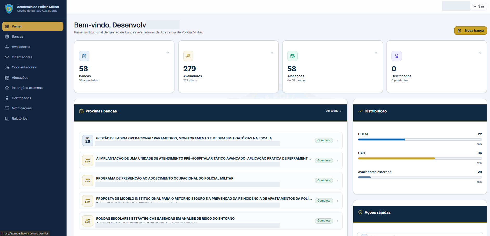
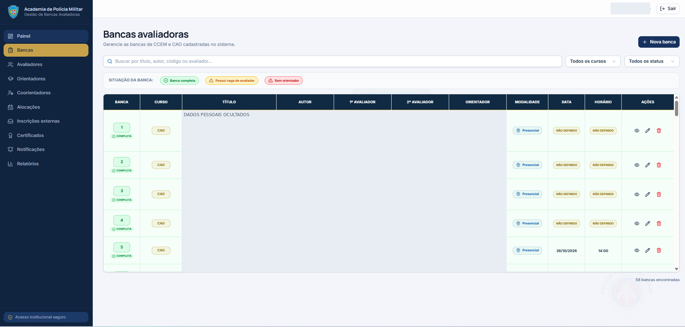
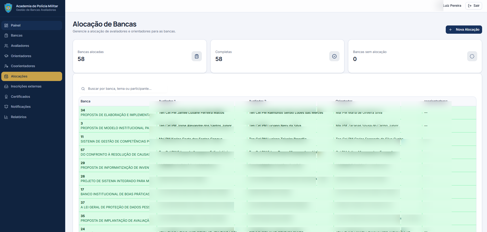

# BancasAPM — Sistema de Gestão de Bancas Avaliadoras

Aplicação web para apoiar a gestão de bancas avaliadoras, alocações, avaliadores, inscrições externas, certificados, notificações e relatórios no contexto da Academia de Polícia Militar da Bahia.

> **Privacidade:** as capturas de tela deste README foram incluídas para demonstrar a interface. Nomes e áreas que exibem dados pessoais foram ocultados nas imagens. Antes de publicar o repositório, revise também o código, os documentos, o histórico do Git e eventuais arquivos de configuração para garantir que não existam dados pessoais, credenciais ou informações institucionais restritas.

## Visão geral

O sistema reúne telas para autenticação, acompanhamento de indicadores, gerenciamento de bancas avaliadoras e alocação dos participantes responsáveis por cada banca.

### Acesso ao sistema


### Painel principal

O painel apresenta indicadores gerais, próximas bancas e distribuição por categoria.



### Bancas avaliadoras

A tela permite consultar e filtrar bancas, visualizar a situação de preenchimento e acessar ações de gerenciamento. Os dados pessoais visíveis na captura original foram ocultados.



### Alocação de bancas

A tela de alocação organiza avaliadores, orientadores e coorientadores associados às bancas. Os nomes de pessoas foram ocultados na imagem de demonstração.



## Tecnologias identificadas

- Next.js 16.2.0, React 19 e TypeScript
- MySQL (`mysql2`)
- Tailwind CSS 4 e componentes Radix UI
- JWT e bcryptjs como dependências relacionadas à autenticação
- Bibliotecas de PDF e planilhas: `jspdf`, `jspdf-autotable`, `pdf-lib` e `xlsx`

## Requisitos

- Node.js compatível com a versão do Next.js definida em `package.json`
- npm
- MySQL 8+ (conforme comentário do script SQL)
- Variáveis de ambiente necessárias ao banco e às integrações usadas no ambiente

## Instalação local

1. Clone o repositório.
2. Instale as dependências:

   ```bash
   npm ci
   ```

3. Crie o arquivo `.env.local` localmente, a partir de `.env.example`, e preencha os valores fornecidos pelo administrador do ambiente.
4. Configure o MySQL. O script `scripts/database_mysql.sql` cria o banco `apm_pmba`.

   **Atenção:** o script inicial contém comandos `DROP TABLE IF EXISTS`. Não o execute em um banco com dados que devam ser preservados. Use-o somente em ambiente descartável ou prepare uma migração não destrutiva.

5. Inicie o servidor:

   ```bash
   npm run dev
   ```

   O script atual usa a porta `3004`; abra `http://localhost:3004`.

## Scripts disponíveis

| Comando | Finalidade |
|---|---|
| `npm run dev` | Servidor de desenvolvimento na porta 3004 |
| `npm run build` | Build de produção |
| `npm run start` | Servidor de produção na porta 3004 |
| `npm run test-db` | Script auxiliar de teste de conexão com banco |
| `npm run test-integration` | Script auxiliar de teste de integração |
| `npm run lint` | Comando de lint definido no `package.json`; valide a compatibilidade com a versão instalada |

## Áreas funcionais identificadas

- Autenticação, perfil, alteração de senha e histórico de login
- Gestão de bancas avaliadoras e alocações
- Cadastro de avaliadores, orientadores e coorientadores
- Inscrições externas e envio/geração de documentos PDF
- Solicitação e gestão de certificados
- Notificações, incluindo rotas relacionadas a WhatsApp
- Dashboard e relatórios

Consulte `docs/BancasAPM_Documentacao_Tecnica.pdf` para arquitetura, inventário de endpoints, modelo conceitual de dados, diagramas, instalação e recomendações de segurança, caso esse arquivo esteja presente no repositório.

## Configuração de ambiente

O SQL menciona `MYSQL_HOST`, `MYSQL_PORT`, `MYSQL_USER`, `MYSQL_PASSWORD`, `MYSQL_DATABASE` ou, alternativamente, `DATABASE_URL`. Confirme no código quais variáveis são efetivamente consumidas.

Nunca faça commit de `.env.local`, credenciais JSON, tokens, chaves ou dados reais. Mantenha um `.env.example` apenas com nomes de variáveis e valores fictícios, sem segredos.

## Segurança e dados

- Revise a autorização no servidor para cada rota administrativa.
- Use consultas parametrizadas e validação de entrada.
- Não publique dumps, backups, credenciais ou dados pessoais.
- Faça backup e teste a restauração antes de qualquer atualização de banco.
- Proteja dados pessoais e histórico de acesso.
- Confirme a licença e a autorização institucional antes de tornar o código público.
- Revise o histórico de commits: remover um arquivo do último commit não garante que ele tenha sido removido do histórico Git.

## Estrutura de diretórios

- `app/`: páginas e endpoints da API
- `components/`: componentes de interface reutilizáveis
- `lib/`, `data/`, `contexts/`, `hooks/`: módulos auxiliares, serviços e estado compartilhado
- `public/`: arquivos estáticos
- `styles/`: estilos
- `scripts/`: scripts auxiliares e SQL
- `docs/images/`: capturas de tela de demonstração usadas neste README, com dados pessoais ocultados

## Testes e validação

Antes de publicar, execute em ambiente limpo:

```bash
npm ci
npm run test-db
npm run test-integration
npm run build
```

Os testes de banco e integração dependem da configuração local. Não execute contra produção sem autorização e backup.

## Documentação

- `docs/BancasAPM_Documentacao_Tecnica.pdf` — documentação técnica e diagramas, se incluída no repositório.
- `CONTRIBUTING.md` — orientações de contribuição, se disponível.
- `CHANGELOG.md` — histórico de alterações, se disponível.

## Licença

A licença deve ser confirmada pelo titular do projeto. O arquivo `LICENSE` existente deve ser revisado antes da publicação pública; não altere ou substitua a licença sem autorização.
